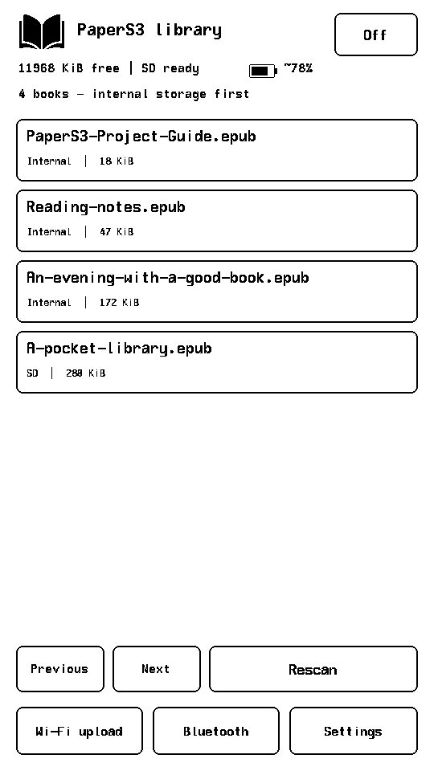
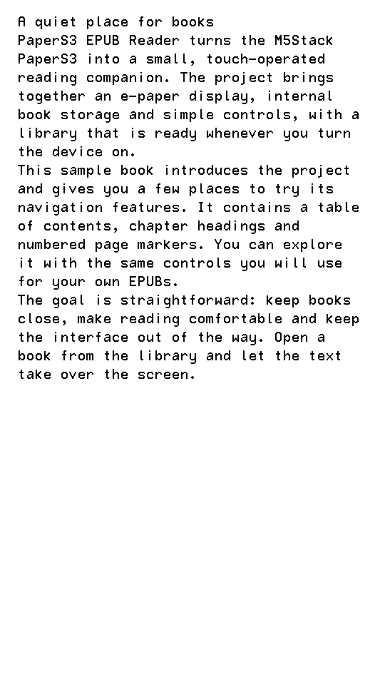
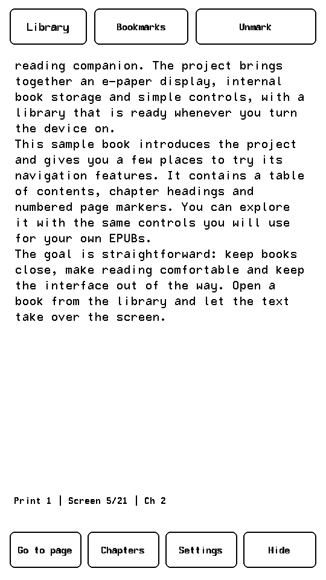
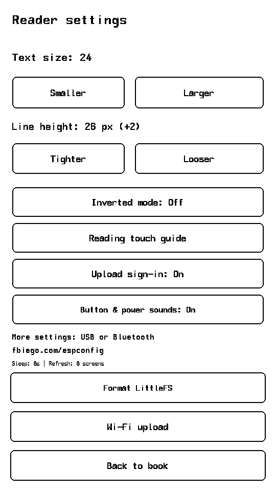
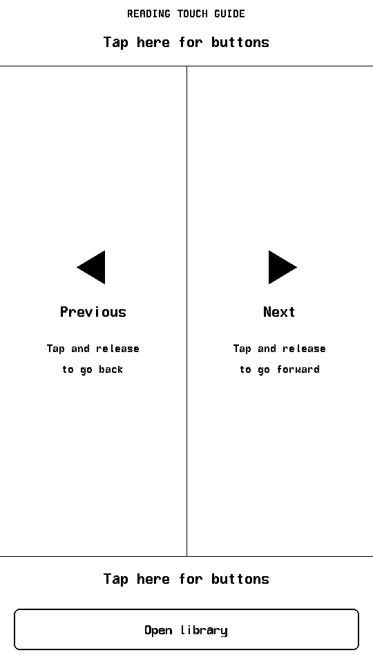
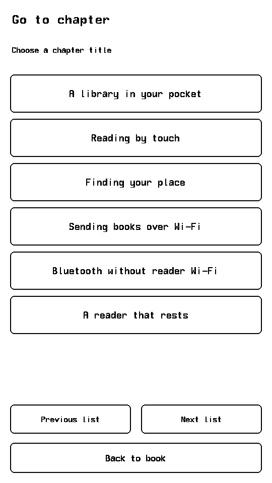
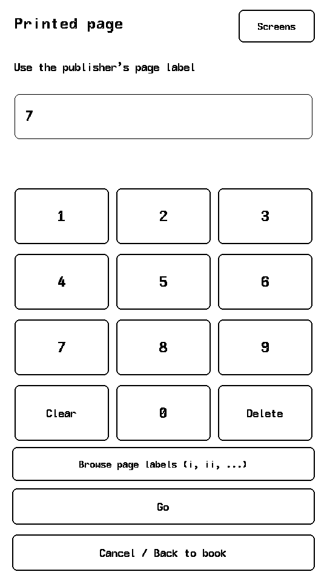
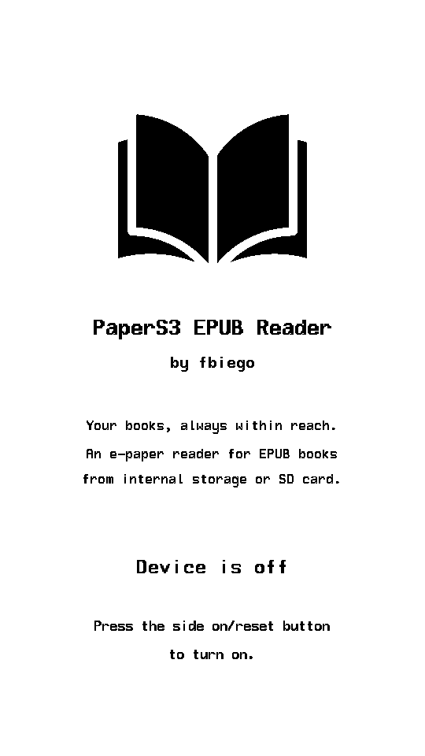

# PaperS3 EPUB Reader

A touch-operated EPUB reader for the **M5Stack PaperS3**, with internal LittleFS storage as the primary library and optional SD card support.

Built with Arduino, [M5GFX](https://github.com/m5stack/M5GFX), tinyxml2, NimBLE-Arduino and [ESPConfig](https://github.com/fbiego/ESPConfig). The firmware targets the PaperS3's 16 MiB flash and 8 MiB PSRAM.


<a href="https://espverse.com/missions/paper-s3-epub"></a>

## Features

- Browse EPUBs from internal storage and an optional SD card.
- Restore reading positions and save up to 32 bookmarks per book.
- Read with hidden controls and tap either side to turn pages.
- Navigate by chapter, reader screen number or publisher page label when available.
- Adjust font size, line spacing and inverted display mode.
- Upload, download and delete internal files over Wi-Fi or BLE.
- Configure settings through USB or Bluetooth with ESPConfig.
- View estimated battery percentage and charging status in the library.
- Enable button clicks and startup/shutdown sounds using the GPIO21 buzzer.
- Use idle light sleep while reading, or the library's Off button for deep sleep.

## UI previews


| Library | Reading | Reading controls | Settings |
| --- | --- | --- | --- |
| <a href="docs/images/library.png"></a> | <a href="docs/images/reading.png"></a> | <a href="docs/images/reading-controls.png"></a> | <a href="docs/images/settings.png"></a> |

| Touch guide | Chapters | Go to page | Powered off |
| --- | --- | --- | --- |
| <a href="docs/images/touch-guide.png"></a> | <a href="docs/images/chapters.png"></a> | <a href="docs/images/go-to-page.png"></a> | <a href="docs/images/off.png"></a> |

Additional previews: [inverted reading](docs/images/reading-inverted.png), [Wi-Fi access](docs/images/wifi.png), and [Bluetooth access](docs/images/bluetooth.png).


## Build and install

Install PlatformIO, connect the PaperS3 over USB, and run these commands from the project directory:

```sh
pio run
pio run -t upload
```

The `m5-paper-s3` environment supplies the ESP32-S3, 16 MiB flash and octal PSRAM build configuration. Display, touch and SD wiring are configured for the PaperS3.

The project uses a custom partition table with a 4 MiB firmware slot. This layout moves LittleFS from `0x310000` to `0x410000`; files from the older 3 MiB firmware layout must be backed up before updating and restored after initializing LittleFS with the new layout. Back up existing internal files before switching from another firmware or partition layout. Upload the complete PlatformIO firmware, including its partition table, rather than only the application binary. Do not restore a filesystem image made for a different layout.

### First boot

1. Follow the full-screen touch guide, then tap **Open library**.
2. If internal storage is uninitialized, open **Settings → Initialize internal storage** and confirm.
3. Configure your Wi-Fi credentials through ESPConfig, or use BLE to transfer a book.
4. Return to the library and tap a book to start reading.

Storage mount failures never trigger automatic formatting. SD books can be read even when internal storage is uninitialized.

For a first book, upload the included [PaperS3 Project Guide](books/PaperS3-Project-Guide.epub) over Wi-Fi or BLE, or copy it to your SD card. This sample EPUB introduces the project in six chapters and includes a table of contents and twelve page markers for exploring navigation.

## Library and reading

The library lists internal EPUBs first, followed by SD EPUBs. Uploads are stored in `/books` on LittleFS. SD books can be placed at the card root or in subfolders. Tap **Rescan** after inserting a card, and close an SD book before removing its card. Scanning includes up to eight directory levels and 512 books; hidden files and folders are skipped.

Startup opens the library. Selecting a previously opened book restores its saved reading position.

### Touch controls

| Area | Action |
| --- | --- |
| Left middle | Previous screen |
| Right middle | Next screen |
| Top or bottom band | Show or hide reading controls |

Controls stay hidden during reading to leave more room for text. When shown, the top row contains **Library**, **Bookmarks** and **Bookmark / Unmark**. The bottom row contains **Go to page**, **Chapters**, **Settings** and **Hide**. Turning a page hides the controls again.

Replay the full-screen guide from **Settings → Reading touch guide**.

### Navigation and bookmarks

**Chapters** lists titles from the EPUB's table of contents and jumps to the selected heading. Books without a usable table of contents show numbered reading sections instead.

**Go to page** offers two forms of navigation:

- **Printed pages:** Available when the EPUB includes a publisher page list. Enter a numeric label or browse labels such as `i`, `ii` and `iii`. Jumps start at the publisher's page marker, independent of font size. A printed page can span several reader screens.
- **Screens:** Uses page numbers calculated for the current font size and line spacing. The reader prepares a book-wide count before accepting a page number. Changing the layout changes these numbers. Indexing can be canceled.

Without a publisher page list, only screen navigation is available. Printed page labels depend on the edition used by the EPUB publisher.

Tap **Bookmark** to save the current page, **Unmark** to remove bookmarks on it, or **Bookmarks** to revisit saved locations. Up to 32 bookmarks are stored per book. Positions and bookmarks follow text offsets when the layout changes. Moving or renaming a file creates a separate reading record.

### Reading appearance and sound

- **Smaller / Larger** adjusts the reading font from 18 to 36 px.
- **Tighter / Looser** adjusts spacing from −6 to +16 px. Line height equals font size plus this offset; very tight spacing can overlap accents and descenders.
- **Inverted mode** uses white text and outlines on a black background throughout the device UI.
- **Button & power sounds** enables button clicks and short startup/shutdown tones. Reading-area page turns and top/bottom control-reveal taps remain silent. Turning sounds off mutes all effects.

These preferences are saved across restarts.

## Wi-Fi file manager

1. Save your network name and password through ESPConfig.
2. From the library, tap **Wi-Fi upload**. The reader joins your existing network; it does not create a hotspot.
3. Connect your phone or computer to the same network and open the HTTP address shown on the reader.
4. If prompted, sign in with username **reader** and the displayed six-digit access code as the password.
5. Upload a DRM-free `.epub`, then tap **Stop Wi-Fi / Library** on the device to return to reading.

The browser page provides drag-and-drop uploads, progress, cancellation, storage usage and a folder browser. Each internal file has **Download** and **Delete** actions; deletion asks for confirmation. File management covers LittleFS only. SD files, settings and bookmarks are not exposed.

Uploads go to `/books`. Existing filenames are rejected, incomplete transfers are removed, and uploaded files are checked for a valid EPUB package before being added to the library. At least 64 KiB of storage is reserved. A book with a malformed chapter may still fail when opened.

**Settings → Upload sign-in** can disable browser authentication. It defaults to On and applies the next time Wi-Fi mode starts. With sign-in disabled, anyone who can reach the reader on that network can manage its internal files. The server uses HTTP, so use a trusted network. Guest networks with client isolation may prevent access.

Connection attempts time out after 30 seconds. Tap **Retry** after correcting credentials or restoring the network. Wi-Fi stops after five minutes without requests by default; this timeout is configurable.

## Bluetooth settings and file transfers

Tap **Bluetooth** in the library to enable BLE. The device displays its name, `PaperS3-xxxx`, and its six-digit access code. Wi-Fi is off in this mode, and only one BLE client can connect at a time.

### Configure settings

Open [ESPConfig](https://fbiego.com/espconfig/), choose **Connect BLE**, select the reader, and enter its displayed code in the password field.

### Transfer books

The BLE file manager is hosted at **[fbiego.com/papers3/](https://fbiego.com/papers3/)**. Open it in Chrome or Edge with Web Bluetooth support. Click **Connect reader**, select the PaperS3, and enter its six-digit code. The tool supports EPUB uploads, folder browsing, downloads and file deletion on LittleFS. The reader does not need Wi-Fi for these transfers.

Web Bluetooth requires a supported browser and a secure page; the reader's ordinary HTTP Wi-Fi page cannot start a BLE connection. Disconnect the file manager before connecting through ESPConfig.

BLE transfers are slower than Wi-Fi. Keep the browser page open and the reader nearby until the transfer finishes. Uploads include size and checksum checks, reject existing filenames and remove incomplete files on cancellation or disconnect.

BLE always requires the access code, even when Wi-Fi sign-in is disabled. The code controls application access; BLE pairing/encryption is not configured. Bluetooth stops when you leave the mode, switch to Wi-Fi, press Off, or leave it idle for five minutes.

## Image preparation before upload

Both upload pages have **Optimize JPEG images for PaperS3**, enabled by default. Before transferring the book, your browser converts progressive JPEGs to baseline JPEGs and scales oversized JPEGs to fit within 540 × 960 pixels while preserving their proportions. Conversion uses 90% JPEG quality. This reduces the ESP32's decoding memory requirements and can reduce transfer time and storage use.

Preparation happens entirely in your browser. Your original EPUB stays unchanged; only the prepared copy is uploaded, using the same filename and internal resource paths. Text, metadata and non-JPEG resources are preserved. The page shows preparation progress and supports cancellation before transfer starts. Storage checks and BLE checksums use the prepared file.

The hosted BLE page uses the shared scripts in `web/epub-prepare.js` and `web/vendor/fflate.js`. The bundled [fflate](https://github.com/101arrowz/fflate) 0.8.3 library is MIT licensed; its notice is included with the script and in `web/vendor/fflate-LICENSE.txt`.

Turn the option off to upload the original EPUB without conversion. Preparation supports books up to 64 MiB and individual JPEG resources up to 16 MiB / 32 megapixels. Signed EPUBs cannot be modified. If preparation fails, the page shows an error and does not upload a partial result. The compression library is bundled locally, including in the firmware's Wi-Fi page; no external conversion service or CDN is used.

## Settings with ESPConfig

For USB configuration, connect the reader, close any serial monitor, and open [ESPConfig](https://fbiego.com/espconfig/) in a browser supporting Web Serial. Choose **Connect Serial**, select the PaperS3 port, adjust settings and save. For wireless configuration, first open **Bluetooth** on the reader and choose **Connect BLE** in ESPConfig.

| Setting | Default / range |
| --- | --- |
| Reading font size | 24 px; 18–36 px |
| Line spacing offset | +2 px; −6 to +16 px |
| Idle before light sleep | 8 seconds; 0 disables it |
| Quality refresh interval | Every 8 pages; 1–30 pages |
| Wi-Fi auto-off | 300 seconds; 60–900 seconds |
| Inverted display | Off |
| Button and power sounds | On |
| Wi-Fi network name and password | Empty |
| Wi-Fi / BLE access code | Random six-digit code, saved across restarts |
| Require Wi-Fi file sign-in | On |

The access code contains exactly six digits, including any leading zeros. You can choose your own through **Wi-Fi / BLE access code (6 digits)**. Upgrading from the older password format generates a new code once. Network credentials, access-code changes and Wi-Fi sign-in changes take effect the next time the relevant wireless mode starts. The Wi-Fi network password is separate from the access code.

The BLE settings list is loaded when Bluetooth starts. Reopen Bluetooth mode if you also changed settings through USB. ESPConfig also provides actions to open Wi-Fi uploads or return to/rescan the library.

Settings are stored in NVS. USB configuration is available to anyone with physical USB access, and the serial port is reserved for ESPConfig communication.

## Battery and power

The library shows an estimated battery percentage, prefixed with `~`, and **Charging** or **USB** when applicable. The percentage is calculated from battery voltage, so it varies with load, charging and battery condition. It is an estimate rather than a fuel-gauge reading.

After the configured idle interval, the reader uses light sleep with the touch controller powered. Touch can wake the device, and a short timer wake keeps polling responsive. Wi-Fi and Bluetooth remain off during normal reading. An active USB serial connection prevents idle sleep.

Tap **Off** in the library to save the reading position, stop wireless services, display an off message and enter deep sleep. The e-paper image stays visible. Screen taps do not wake this mode; press the physical on/reset button to restart into the library. This is deep sleep rather than a complete battery power disconnect. Battery runtime depends on refresh frequency, wireless use and sleep behavior.

## Internal storage

The custom layout prioritizes book storage on the 16 MiB flash:

| Partition | Offset | Size |
| --- | --- | --- |
| NVS: settings and reading records | `0x9000` | 24 KiB |
| PHY | `0xF000` | 4 KiB |
| Firmware | `0x10000` | 4 MiB |
| LittleFS | `0x410000` | 11.9375 MiB |

Usable file space is lower because of filesystem overhead. The partition uses the Arduino core's `spiffs` label/subtype but is mounted as LittleFS. There is one firmware slot and no OTA partition; firmware updates use USB.

To erase internal files, open **Settings → Format LittleFS → Erase internal storage**. This permanently removes all LittleFS files and recreates `/books`. SD files, settings and bookmarks are kept. The browser upload page is embedded in firmware and remains available after formatting. Keep the device powered during the operation.

Reading records share the finite NVS partition. The UI reports a save failure if there is insufficient space for additional records.

## EPUB support and limitations

The reader is designed for DRM-free EPUBs with reflowable content. It supports EPUB manifest/spine reading order, well-formed XHTML, UTF-8 text, common HTML entities, paragraph breaks, EPUB 3 navigation and EPUB 2 NCX navigation.

### Images

Embedded PNG and baseline or progressive JPEG images appear on their own screens between the surrounding text. Images are scaled down to fit while preserving their proportions, centered, and converted to grayscale with dithering. Small images are kept at their original size. Alt text appears as a short caption when provided. Image screens participate in page counts, bookmarks and saved reading positions.

Images retain their normal grayscale appearance in inverted mode; transparent areas use white. Raster images inside SVG cover wrappers are supported, but SVG vector artwork, GIF, WebP, lossless or 12-bit JPEG, interlaced PNG and external image URLs are not. Missing, oversized or undecodable images show a message and any available alt text, so reading can continue.

Image resources are limited to 2 MiB each, 4096 pixels per dimension and 4 megapixels total, with up to 512 image references per chapter. JPEG decoding uses libjpeg-turbo with PSRAM allocations, a shared 4 MiB limit for codec/output buffers, a 512 KiB PSRAM reserve and a 128-scan limit. Large progressive images can exceed the memory budget even when they meet the dimension limits; these show an error instead of loading. Only the visible image is extracted and decoded; page indexing uses its position without loading image bytes. Image screens use a quality refresh. Firmware project logos continue to use the supplied 1-bit bitmaps; browser pages use the original PNG.

### Other limits

CSS layout, embedded fonts, fixed-layout rendering, table grids, DRM, ZIP64 and multi-disk archives are not supported. The bundled font does not cover every Unicode character, and complex-script or right-to-left shaping is not implemented. CFI navigation targets are not supported.

Resource limits include 1 MiB per expanded chapter, 2 MiB per compressed resource, 512 KiB for OPF metadata, 64 KiB for container XML, and 256 KiB per navigation resource. Archives are limited to 8192 entries, reading order to 4096 sections, and navigation lists to 4096 entries. Additional filename and XML-complexity limits bound memory use. Oversized books may report an error or omit optional navigation; splitting large chapters improves compatibility.

## JPEG decoder attribution

JPEG decoding uses a vendored portable build of [libjpeg-turbo 3.2.0](https://github.com/libjpeg-turbo/libjpeg-turbo/tree/3.2.0). Its license notices and integration details are included in [lib/LibJpegTurbo](lib/LibJpegTurbo).

This software is based in part on the work of the Independent JPEG Group.
